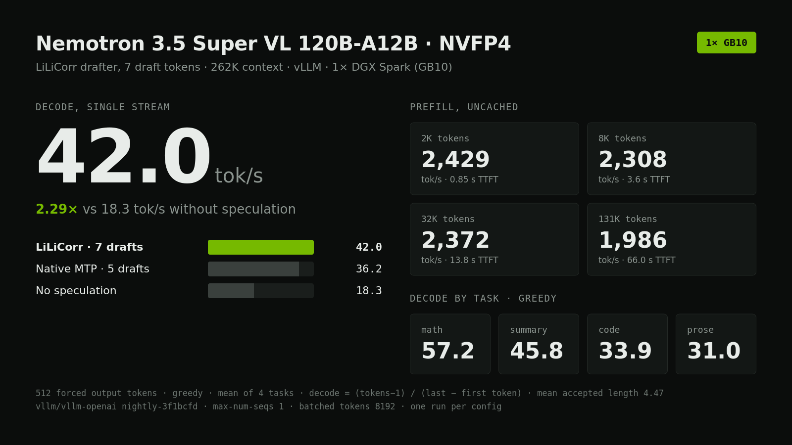

# Nemotron 3.5 Super VL on one DGX Spark

The fastest single-GB10 recipe we measured for NVIDIA Nemotron 3.5 Super VL 120B-A12B NVFP4: vLLM, the LiLiCorr drafter with 7 draft tokens, 262K context.



## Result

| Config | Decode, greedy | Decode, sampled | Prefill 2K | Prefill 8K | Prefill 32K | Prefill 131K |
|---|---:|---:|---:|---:|---:|---:|
| **LiLiCorr, 7 drafts (this recipe)** | **42.0** | **43.4** | 2,429 | 2,308 | 2,372 | 1,986 |
| LiLiCorr, 5 drafts | 41.2 | 40.9 | 2,410 | 2,878 | 2,991 | |
| Native MTP, 5 drafts ¹ | 36.2 | 35.0 | 1,682 | 2,328 | 2,362 | |
| Native MTP, 3 drafts ¹ | 36.1 | 34.8 | 1,769 | 2,364 | 2,388 | |
| No speculation | 18.3 | 18.3 | 2,015 | 2,609 | 2,809 | |

All values tok/s, single stream, 262K max context. Decode is the mean of 4 tasks.

Decode by task, LiLiCorr 7, greedy: math 57.2, summary 45.8, code 33.9, prose 31.0 tok/s. Mean accepted length 4.47 tokens per verification step.

¹ MTP could only start on one GB10 with FlashInfer autotune disabled (`--kernel-config '{"enable_flashinfer_autotune":false}'`). With autotune on, host memory fell below a 5 GiB reserve during startup.

## Run it

Requirements: one GB10 (128 GB unified memory), Docker with the NVIDIA runtime, and both checkpoints:

```bash
hf download nvidia/NVIDIA-Nemotron-3.5-Super-VL-120B-A12B-NVFP4 \
  --revision 2e5cc3953bb1ea66b2fb7c831fee3aa317427e69 \
  --local-dir ~/models/NVIDIA-Nemotron-3.5-Super-VL-120B-A12B-NVFP4
hf download nvidia/NVIDIA-Nemotron-3.5-Super-VL-120B-A12B-NVFP4-LiLiCorr \
  --revision 7c7221aeb4cb3139307aa457f7dce11a8fb6ceb2 \
  --local-dir ~/models/NVIDIA-Nemotron-3.5-Super-VL-120B-A12B-NVFP4-LiLiCorr

docker pull vllm/vllm-openai:nightly-3f1bcfd82bb2e93fcd364fc7a5491718453a77e2
./serve.sh
```

The server listens on `127.0.0.1:8000` with model name `nemotron-3.5-super-vl`. First start takes about 11 minutes: about 7 to load 70 GB of weights, then compilation and CUDA graph capture.

```bash
curl -s http://127.0.0.1:8000/v1/chat/completions -H 'Content-Type: application/json' -d '{
  "model": "nemotron-3.5-super-vl",
  "messages": [{"role": "user", "content": "Compute 17*23. Reply with only the integer."}],
  "max_tokens": 2048, "temperature": 0}'
```

## What changed from NVIDIA's DGX Spark quick-start

`serve.sh` is NVIDIA's published DGX Spark command with two additions. Without them, the server does not start on one GB10:

- `--max-model-len 262144`. The 1M default sizes encoder and cache buffers that push host memory below 5 GiB during startup.
- `--limit-mm-per-prompt '{"video":0,"image":999}'`. Video input is disabled. Images are uncapped (vLLM's default of 999 per prompt); a 12-image prompt was verified. The video encoder memory profile is what exhausts memory.

Also recommended: during weight loading, the 70 GB of shards fill page cache and can push the host into swap. `bench/watchdog.py` evicts clean model-file pages every 2 s until the server is healthy, and kills the container if available memory drops below 5 GiB or swap grows by more than 8 GiB.

## Does not fit on one GB10

- **Larger prefill batches.** `--max-num-batched-tokens 16384` or `32768` leaves too little memory for KV cache. At 262K context, vLLM refuses to start (14.6 GiB needed, 6.1 GiB available at 32K batch).
- **1M context with video.** Startup drops host memory below 5 GiB.
- **Native MTP with FlashInfer autotune.** Autotune scratch drops host memory from about 17 GiB to under 5 GiB in the last 30 s of startup.

## Method

- Decode: 512 forced output tokens (`ignore_eos`), one request at a time, 4 tasks (code, prose, math, long-document summary), greedy plus one sampled pass at T=1.0, top_p=0.95. Decode tok/s = (completion tokens − 1) / (last token time − first token time), from the SSE stream.
- Prefill: uncached prompts (a unique nonce at the start defeats prefix caching), `max_tokens=1`, prefill tok/s = prompt tokens / time to first token.
- Every config passed an exact-answer smoke (`17*23` → `391`, `finish_reason=stop`) before measurement.
- Speculative acceptance comes from vLLM's `/metrics` counters, as a delta per request.
- One run per configuration. Small differences, such as LiLiCorr 7 vs 5, are within run-to-run noise. Prefill numbers between configs were not tightly reproducible: the same LiLiCorr 7 recipe measured 2,882 / 2,993 tok/s at 8K / 32K in a separate run at 65K context.

`results.json` has every row. `bench/bench.py` reproduces the measurements against a running server; set `CORPUS_DIR` to any large source tree for the prefill corpus.

## Pinned versions

- Model: `nvidia/NVIDIA-Nemotron-3.5-Super-VL-120B-A12B-NVFP4` @ `2e5cc3953bb1ea66b2fb7c831fee3aa317427e69`
- Drafter: `nvidia/NVIDIA-Nemotron-3.5-Super-VL-120B-A12B-NVFP4-LiLiCorr` @ `7c7221aeb4cb3139307aa457f7dce11a8fb6ceb2`
- Runtime: `vllm/vllm-openai:nightly-3f1bcfd82bb2e93fcd364fc7a5491718453a77e2` (vLLM 0.32.0rc1.dev190+g3f1bcfd82, arm64)
- All 93 LFS files were SHA-256 verified against the pinned Hub revisions.

## Credits

Model, LiLiCorr drafter and base serving command: NVIDIA. Runtime: vLLM.
Model license: [OpenMDW-1.1](https://openmdw.ai/license/1-1/).
